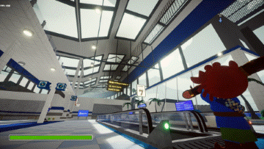
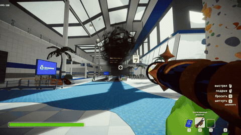
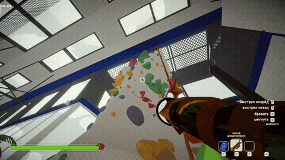
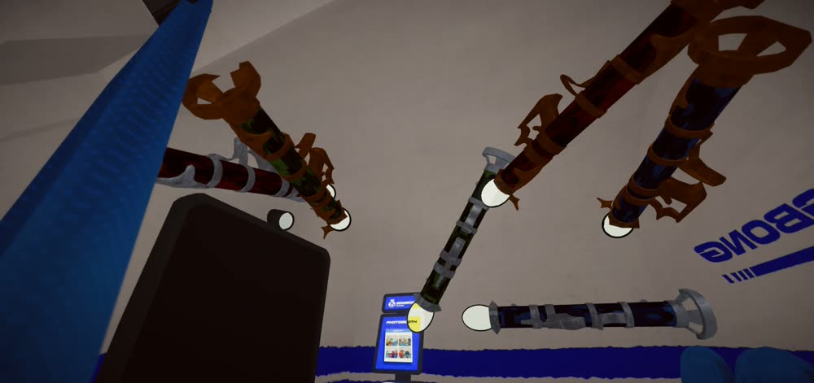

# Dynamite Launcher

A new item for PEAK: a camo **Dynamite Launcher** built on the Anti-Zooka. It fires a slow, lit flare that turns into instantly exploding dynamite on impact.

## Gameplay

## Variants

| Variant | Look | Ammo |
|---|---|---|
| Silver | Red camo barrel, silver frame | 3 shots (configurable) |
| Gold | Red camo barrel, original gold frame | Infinite (configurable) |
| Dynamite Jumper (silver) | Green camo barrel, silver frame | 3 shots (configurable) |
| Golden Dynamite Jumper | Green camo barrel, original gold frame | Infinite (configurable) |
| Guided Dynamite Launcher (silver) | Blue camo barrel, silver frame | 3 shots (configurable) |
| Golden Guided Dynamite Launcher | Blue camo barrel, original gold frame | Infinite (configurable) |

The **Guided Dynamite Launcher** fires the same slow flare and the same real dynamite on impact as the normal launcher, but you fly with the flare: the camera smoothly leaves your eyes and is mounted rigidly on top of the flare body (30 cm up and 30 cm back by default, so the nose sticks out ahead), the flare never rolls so the view stays level, the flare sound is muted for you, and the mouse steers the flare (your character does not turn meanwhile). The right mouse button always detonates the flare in flight. When the flare ends for any reason (impact, remote detonation, timeout), the view snaps back to your eyes instantly. Steering and camera are local to the shooter; other players just see the flare.

The **Dynamite Jumper** fires the same flare, but its blast is harmless: no real dynamite, no stun, no injury, and no fall damage right after the jump. It only throws you away from the blast point, so shoot at your feet to jump. Everyone nearby is pushed, but only players with the mod see the green explosion; others just see the flare vanish. Left mouse button fires from the front; hold the right mouse button (as long as a normal charge, so the `ChargeSpeedMultiplier` setting applies; a filling circle shows the progress) to fire from the rear end of the barrel, so the flare flies backwards and the blast throws you toward the crosshair (costs one charge, same as a normal shot).

## How to get it

By default, use an item spawner such as ItemSpawnerPremium to find “Dynamite Launcher”, “Golden Dynamite Launcher”, “Dynamite Jumper”, “Golden Dynamite Jumper”, “Guided Dynamite Launcher” and “Golden Guided Dynamite Launcher”. The host can also enable world loot in the configuration.

## Multiplayer

Other players can join your lobby without installing the mod. When you fire the Dynamite Launcher, everyone can see the flare and the explosion because both use networked PEAK objects.

Players without the mod see a standard Anti-Zooka and get its usual shot if they pick it up and fire it. Players with the mod see the launcher’s custom name, camouflage and inventory icon.

## Configuration

Save changes to `BepInEx/config/capitan.peak.dynamitelauncher.cfg` while PEAK is running and the mod reloads them automatically. The silver launcher’s starting ammo count applies to newly spawned launchers. The file is created on first launch.

| Section | Setting | Default | Values | Effect |
| --- | --- | --- | --- | --- |
| `[Loot]` | `SpawnInLoot` | `false` | true / false | Host only. Master switch for world loot: while off, no launcher or jumper spawns in luggage or statues, and the loot settings below are ignored. |
| `[Loot]` | `EnableRareChestLoot` | `false` | true / false | Host only. Adds both launchers to ordinary luggage. |
| `[Loot]` | `ChestLootRarity` | `Rare` | Common, Uncommon, Rare, Epic, Legendary, Mythic, RidiculouslyRare | Host only. Sets the loot weight of both launchers in ordinary luggage when EnableRareChestLoot is enabled. |
| `[Loot]` | `EnableMagicalLoot` | `false` | true / false | Host only. Adds both launchers to statue rewards and ancient luggage with Mythic weight. |
| `[Loot]` | `JumperEnableRareChestLoot` | `false` | true / false | Host only. Adds both Dynamite Jumpers to ordinary luggage. |
| `[Loot]` | `JumperChestLootRarity` | `Rare` | Same values as ChestLootRarity | Host only. Loot weight of both Dynamite Jumpers in ordinary luggage. |
| `[Loot]` | `JumperEnableMagicalLoot` | `false` | true / false | Host only. Adds both Dynamite Jumpers to statue rewards and ancient luggage with Mythic weight. |
| `[Jumper]` | `SilverAmmo` | `3` | 1–999 shots | Starting ammo for newly spawned silver Dynamite Jumpers. |
| `[Jumper]` | `GoldInfiniteAmmo` | `true` | true / false | Gives the golden Dynamite Jumper infinite ammo. |
| `[Jumper]` | `LaunchSpeed` | `120` | 0–300 m/s | Speed the blast gives at point-blank range; fades with distance. |
| `[Jumper]` | `BlastRange` | `6` | 0.5–30 m | Blast radius; the push fades with distance. |
| `[Jumper]` | `UpwardBias` | `0.7` | 0–5 | Extra upward push. 0 pushes straight away from the blast point. |
| `[Loot]` | `GuidedEnableRareChestLoot` | `false` | true / false | Host only. Adds both Guided Dynamite Launchers to ordinary luggage. |
| `[Loot]` | `GuidedChestLootRarity` | `Rare` | Same values as ChestLootRarity | Host only. Loot weight of both Guided Dynamite Launchers in ordinary luggage. |
| `[Loot]` | `GuidedEnableMagicalLoot` | `false` | true / false | Host only. Adds both Guided Dynamite Launchers to statue rewards and ancient luggage with Mythic weight. |
| `[Guided]` | `SilverAmmo` | `3` | 1–999 shots | Starting ammo for newly spawned silver Guided Dynamite Launchers. |
| `[Guided]` | `GoldInfiniteAmmo` | `true` | true / false | Gives the golden Guided Dynamite Launcher infinite ammo. |
| `[Guided]` | `CameraHeightCm` | `30` | 0–3000 cm | How far above the flare axis the camera is mounted (fixed to the flare). |
| `[Guided]` | `CameraBackCm` | `30` | 0–3000 cm | How far behind the flare centre the camera is mounted (fixed to the flare). |
| `[Guided]` | `CameraBlendMs` | `400` | 50–3000 ms | How long the camera takes to fly from your eyes onto the flare. |
| `[Guided]` | `TurnSpeedPercent` | `100` | 10–500 % | Mouse steering strength on top of the game's mouse sensitivity. |
| `[Guided]` | `TurnSmoothing` | `8` | 1–60 | How quickly steering follows the mouse. Lower is smoother but laggier. |
| `[Launcher]` | `ChargeSpeedMultiplier` | `1` | 0.1–10× | Charge speed for both variants. 2× halves the charge time. |
| `[Launcher]` | `DetonateOnRightClick` | `true` | true / false | Right mouse button detonates all flares in flight fired from the launcher you hold. |
| `[Launcher]` | `ReplaceOthersShots` | `false` | true/false | For launchers you created: when a player without the mod fires one, replace their anti-gravity sphere with the flare. Works from any client, not only the host. |
| `[Ammo]` | `SilverAmmo` | `3` | 1–999 shots | Starting ammo for newly spawned silver launchers. |
| `[Ammo]` | `GoldInfiniteAmmo` | `true` | true / false | Gives the gold launcher infinite ammo. |
| `[Flare]` | `Speed` | `14` | 1–200 m/s | Flare flight speed. |
| `[Flare]` | `LifetimeSeconds` | `25` | 1–600 s | Time before a flare expires in flight. |
| `[Flare]` | `CollisionRadius` | `0.12` | 0.01–2 m | Radius used to detect impacts. |
| `[Flare]` | `SpawnOffset` | `0.6` | Number (m) | Distance in front of the muzzle where the flare spawns. |
| `[Flare]` | `Lit` | `true` | true / false | Fire a lit, glowing flare. If false, the flare flies unlit. |
| `[Flare]` | `ColorHex` | `#FF1A1A` | Hex color, e.g. #FF1A1A | Flare light color. Invalid values fall back to red. |
| `[Explosion]` | `OffsetFromSurface` | `0.3` | Number (m) | Distance from the hit surface where the dynamite explodes. |
| `[Explosion]` | `DynamiteDestroyDelaySeconds` | `0.2` | Number (s) | Time before the exploded dynamite is removed. |
| `[Visual]` | `Camo` | `true` | true / false | Shows red barrel camouflage locally. |
| `[Visual]` | `SilverTrim` | `true` | true / false | Shows the silver launcher’s silver trim locally. |

The loot settings apply to future rolls. Statues still prioritize reviving players when the game allows it. Players without the mod see and use a standard Anti-Zooka.

## Localization

Item names and descriptions are translated into all 15 languages the game supports.

## Known limitations

- The guided camera does not check collisions with terrain; the flare explodes on impact anyway.
- Inventory slot icons are replaced only for players with the mod.
- If the lobby host does not have the mod, the variant marker may not be synced to the host, so the launcher can behave like a stock Anti-Zooka for the host.

## Source

https://github.com/DoomSalat/PEAK-mode-Dynamite-Launcher

**Take the arsenal with you and have fun!**

*I do not endorse open trolling with this mod. Everyone who suffered from it: use my mod [PEAK Sentinel](https://thunderstore.io/c/peak/p/Capitan_Salat/Peak_Sentinel/), which protects your lobby from cheating and unwanted modifications.
